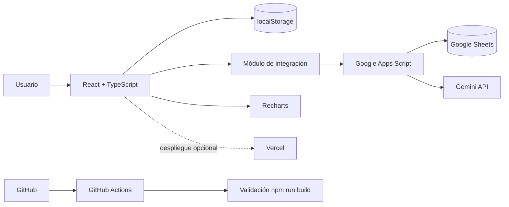
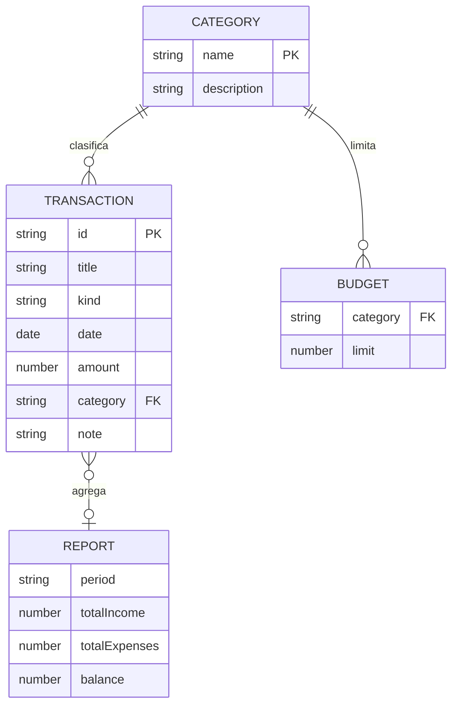
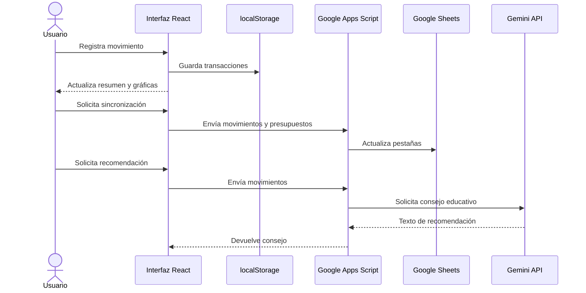

# FinanSmart 💸
**Aplicación web para registrar ingresos, controlar gastos, definir presupuestos y visualizar reportes.**

FinanSmart es un proyecto académico construido con React, TypeScript y Vite. La interfaz funciona localmente con `localStorage`; de forma opcional puede sincronizar movimientos con Google Sheets mediante Google Apps Script y solicitar recomendaciones educativas a Gemini API a través del mismo puente.

> **Importante:** el proyecto usa datos de demostración y almacenamiento local. No es una aplicación bancaria, no se conecta a cuentas financieras y no debe usarse para almacenar datos financieros sensibles sin autenticación, controles de acceso y una revisión de seguridad.

## 1. Problema y objetivo
Muchas personas no tienen una vista sencilla de sus ingresos, gastos y límites mensuales. FinanSmart reúne estos datos en un panel visual para ayudar a comprender hábitos de consumo y planificar presupuestos.

### Objetivo general
Diseñar e implementar una aplicación web de finanzas personales que permita gestionar movimientos económicos, organizar presupuestos por categoría y consultar reportes mediante una interfaz clara, integrando herramientas TIC externas.

### Objetivos específicos
- Registrar, consultar y eliminar ingresos y gastos.
- Agrupar gastos por categorías y visualizar indicadores.
- Crear límites presupuestarios y detectar excedentes.
- Exportar movimientos a CSV.
- Integrar Google Sheets/Apps Script y Gemini API de forma opcional.
- Automatizar la validación del proyecto con GitHub Actions.

## 2. Tecnologías y herramientas TIC

| Tecnología | Función |
|---|---|
| React + TypeScript + Vite | Framework de interfaz, componentes y compilación |
| Recharts | Gráficas de actividad y distribución de gastos |
| Google Sheets | Hoja externa para almacenar movimientos y presupuestos |
| Google Apps Script | Puente entre la aplicación, Sheets y Gemini |
| Gemini API | Generar orientación educativa basada en los movimientos |
| GitHub Actions | Ejecutar instalación y build al hacer push o Pull Request |
| Vercel (opcional) | Publicar el frontend |

La rúbrica pide al menos 3 herramientas TIC; para la presentación se recomienda demostrar Google Sheets/Apps Script, Gemini API y GitHub Actions. Vercel puede ser la plataforma de despliegue.

## 3. Funcionalidades
1. **Resumen:** balance, ingresos, gastos, tasa de gasto, gráfica de actividad y distribución por categoría.
2. **Movimientos:** alta, búsqueda, filtro por tipo, eliminación y exportación CSV.
3. **Presupuestos:** crear/actualizar límites por categoría y visualizar cuánto se ha gastado.
4. **Reportes:** distribución de gastos, métricas agregadas y recomendación educativa.
5. **Persistencia local:** los datos se guardan en el navegador mediante `localStorage`.
6. **Integración opcional:** sincronización a Sheets y consejo de Gemini mediante Apps Script.

### Recursos gestionados (más de 4)
- Transacciones (ingresos y gastos).
- Categorías.
- Presupuestos.
- Reportes agregados.
- Consejos generados a partir del resumen de movimientos.

## 4. Vistas principales
- `/` — Resumen general.
- Vista interna **Movimientos**.
- Vista interna **Presupuestos**.
- Vista interna **Reportes**.

La navegación está controlada por estado de React; las vistas son secciones de una SPA y no rutas URL separadas.

## 5. Requisitos
- Node.js 20 o superior recomendado.
- npm.
- Git.
- Cuenta de GitHub.
- Opcional: cuenta de Google para Apps Script/Sheets y una clave de Gemini API.

## 6. Instalación y ejecución
```bash
npm install
cp .env.example .env
npm run dev
```
Abre la URL local que muestre Vite (normalmente `http://localhost:5173`).

Para compilar:
```bash
npm run build
npm run preview
```

## 7. Configurar Google Sheets y Gemini (opcional)
1. Crea una hoja de cálculo de Google.
2. Crea o deja que el script cree las pestañas `Transactions` y `Budgets`.
3. Abre **Extensiones → Apps Script** y copia `google-apps-script/Code.gs`.
4. Reemplaza `REEMPLAZA_CON_EL_ID_DE_TU_GOOGLE_SHEET` por el ID de tu hoja.
5. En **Configuración del proyecto → Propiedades del script**, agrega `GEMINI_API_KEY` con tu clave (opcional). No pongas la clave en el frontend ni la subas a GitHub.
6. Despliega como aplicación web y copia la URL de implementación.
7. Añade esa URL a `.env` como `VITE_APPS_SCRIPT_URL=...`.
8. Reinicia `npm run dev`.

El acceso del despliegue debe ajustarse a la demostración. El ejemplo es educativo y no implementa autenticación/autorización por usuario; no publiques datos reales sensibles. La llamada de sincronización usa `no-cors` desde el frontend, por lo que el navegador no puede leer una confirmación detallada. Verifica el resultado directamente en Sheets. Para un despliegue real, usa un backend autenticado y validación de permisos.

## 8. Arquitectura



## 9. Diagrama entidad-relación



**Nota del modelo:** en el prototipo, `category` se guarda como texto y los reportes se calculan en tiempo real; el diagrama describe el modelo lógico propuesto para una evolución con base de datos relacional.

## 10. Flujo de datos



## 11. Modelo de datos
### Transaction
| Campo | Tipo | Descripción |
|---|---|---|
| `id` | string | Identificador único |
| `title` | string | Descripción del movimiento |
| `category` | string | Categoría |
| `date` | YYYY-MM-DD | Fecha |
| `amount` | number | Monto positivo en COP |
| `kind` | `Ingreso` / `Gasto` | Tipo |
| `note` | string opcional | Nota libre |

### Budget
| Campo | Tipo | Descripción |
|---|---|---|
| `category` | string | Categoría presupuestada |
| `limit` | number | Límite mensual en COP |

## 12. Reglas de negocio
- El monto de un movimiento debe ser mayor que cero.
- Los ingresos y gastos se almacenan como montos positivos y se distinguen por `kind`.
- Balance = suma de ingresos − suma de gastos.
- Tasa de gasto = gastos / ingresos × 100, si hay ingresos.
- Gasto de categoría = suma de movimientos tipo `Gasto` de esa categoría.
- Un presupuesto se marca excedido cuando el gasto registrado supera su límite.
- Los datos de demostración pueden borrarse desde el navegador eliminando las claves `finansmart-transactions` y `finansmart-budgets` del `localStorage`.

## 13. GitHub: ramas y Pull Requests
Flujo sugerido para el equipo:
- `main`: versión estable.
- `develop`: integración.
- `feature/dashboard`: resumen y gráficas.
- `feature/transactions`: movimientos y CSV.
- `feature/budgets-reports`: presupuestos y reportes.

Ejemplo:
```bash
git init
git add .
git commit -m "feat: scaffold inicial de FinanSmart"
git branch -M main
git remote add origin https://github.com/TU-USUARIO/finansmart.git
git push -u origin main
git checkout -b develop
git push -u origin develop
git checkout -b feature/transactions
# trabajar, guardar cambios y subir la rama
git add .
git commit -m "feat: gestionar movimientos"
git push -u origin feature/transactions
```
Luego abre un Pull Request de `feature/transactions` hacia `develop`. Repite el flujo con las demás ramas y crea un PR de `develop` hacia `main`. Cambia `TU-USUARIO` por el nombre real del propietario del repositorio.

GitHub Actions ejecuta `npm ci` y `npm run build` en `push` a `main`/`develop` y en Pull Requests a `main`.

## 14. Despliegue en Vercel
1. Sube el repositorio a GitHub.
2. Importa el repositorio en Vercel.
3. Usa `npm run build` como comando de compilación y `dist` como directorio de salida.
4. Añade `VITE_APPS_SCRIPT_URL` en variables de entorno si configuraste la integración.
5. Vuelve a desplegar después de agregar variables.

No incluyas claves privadas en variables `VITE_*`: Vite las incorpora al bundle público. La clave de Gemini debe quedarse en Script Properties del backend Apps Script o en un backend seguro.

## 15. Plan de trabajo para 3 integrantes
| Integrante | Responsabilidad | Entregable |
|---|---|---|
| 1 | UI, diseño y prototipo en Stitch | Pantallas y estilos |
| 2 | Movimientos, presupuestos y reportes | Lógica de negocio y validaciones |
| 3 | Apps Script, Gemini, GitHub Actions y README | Integraciones y documentación |
| Todos | Revisión, pruebas y video | PR revisados y demo final |

## 16. Plan de pruebas
- Registrar ingreso válido y comprobar que aumenta el balance.
- Registrar gasto válido y comprobar que disminuye el balance.
- Rechazar monto vacío, cero o negativo.
- Buscar movimiento por descripción/categoría.
- Filtrar por ingreso o gasto.
- Eliminar un movimiento y comprobar que se actualizan los indicadores.
- Crear presupuesto y comprobar el porcentaje utilizado.
- Exportar CSV y abrirlo en una hoja de cálculo.
- Ejecutar `npm run build`.
- Si Apps Script está configurado, revisar que Sheets reciba los datos y que Gemini devuelva una recomendación.

## 17. Alcance y limitaciones
- La persistencia local está ligada al navegador y dispositivo.
- Los datos de ejemplo son ficticios.
- No hay inicio de sesión ni sincronización multiusuario.
- No hay conexión con bancos ni procesamiento de pagos.
- La integración con Apps Script requiere configuración manual y permisos adecuados.
- Los consejos de IA son orientativos, no recomendaciones financieras profesionales.

## 18. Video de presentación (máximo 5 minutos)
1. **Integrante 1 (1 min):** problema, objetivo, público y prototipo.
2. **Integrante 2 (1 min 30 s):** registro de movimientos, presupuestos y reportes.
3. **Integrante 3 (1 min 30 s):** integración Google Sheets/Gemini y GitHub Actions.
4. **Todos (1 min):** arquitectura Mermaid, pruebas y conclusiones.

## 19. Referencias técnicas
- React: https://react.dev/
- Vite: https://vite.dev/
- Recharts: https://recharts.org/
- Google Apps Script: https://developers.google.com/apps-script
- Gemini API: https://ai.google.dev/gemini-api/docs
- GitHub Actions: https://docs.github.com/actions
- Vercel: https://vercel.com/docs
